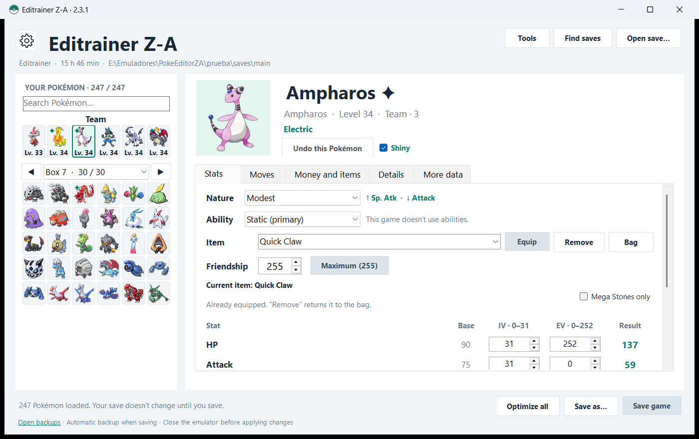
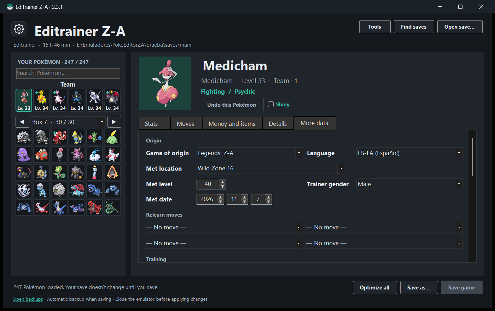
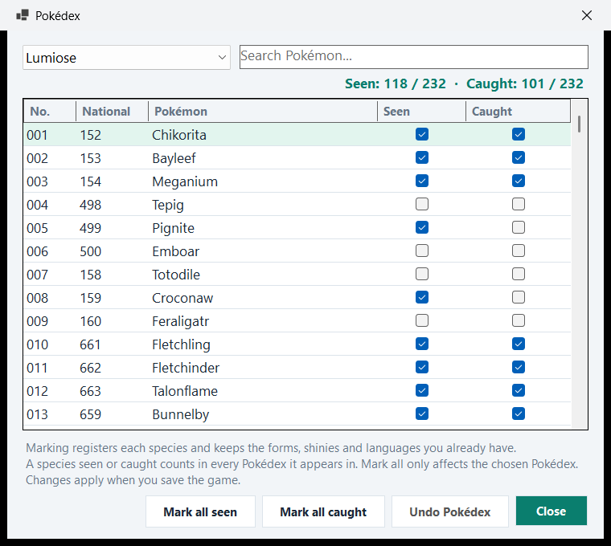
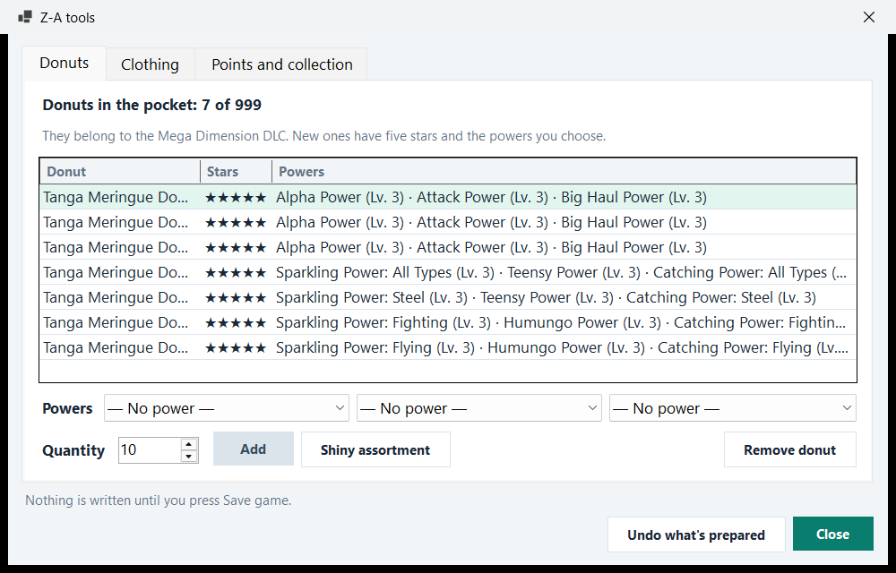
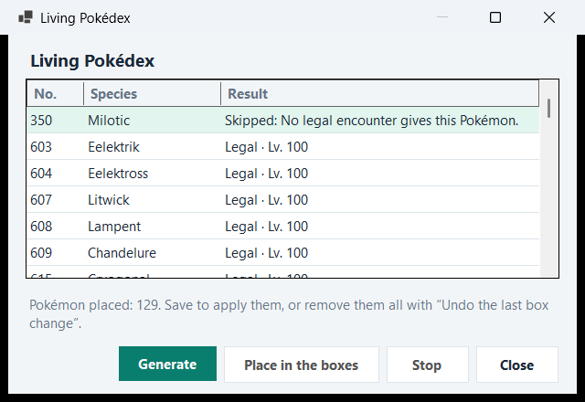

# Editrainer

Save editor for every main Pokémon game, from Game Boy to Switch, on your own Windows PC. Pick a Pokémon and change its stats, moves, form, item or shiny status; edit your money, items, trainer and Pokédex; make legal Pokémon; and get a verified backup every time you save.

## Get started

1. Install the [.NET Desktop Runtime 10](https://dotnet.microsoft.com/download/dotnet/10.0): Windows, x64 installer.
2. **[Download Editrainer-windows.zip](https://github.com/Kaze787/Editrainer/releases/latest/download/Editrainer-windows.zip)** and extract it with **Extract All…**. The app can't run from inside the ZIP.
3. In the new folder, double-click `Download-Images.bat` to fetch the Pokémon images. This is optional: about 360 MB from [PokeAPI/sprites](https://github.com/PokeAPI/sprites), which aren't distributed with the app.
4. Double-click `Editrainer.exe`. It opens your most recent save by itself, and it speaks your Windows language if it's one of its nine.

If Windows says it protected your PC, click **More info** and then **Run anyway**: the app isn't digitally signed. If it doesn't open or stays frozen, check your antivirus. Windows only.

## What it does

- **Each Pokémon**: IVs, EVs, nature, ability, moves, form, held item, friendship, Poké Ball, nickname, trainer and shiny status. **More data** adds origin, ribbons and marks, contest stats, Pokérus, PP Ups, relearn moves, hyper training, Tera type, Dynamax, size and markings, each game showing what it stores.
- **Apply to many**: one change on the team, a box or everyone. What a Pokémon can't take is skipped and explained, and the last batch can be undone.
- **Money and items**, the **trainer**, and the **Pokédex** the way each game orders it: regional, national and DLC lists.
- **Boxes**: move, swap, clone, delete, import, export, sort and rename, with undo.
- **Legal Pokémon**: generate from a Showdown set, or fill a **Living Pokédex**, with the Auto-Legality Mod engine. Each one passes PKHeX's legality check before it is placed.
- **Game extras**: daycare, received gifts, Hall of Fame, raids, Pokéathlon points and secret bases, each game offering what it keeps.
- **Legends: Z-A**: donuts, clothing, Royale and hyperspace points, Colorful Screws and the TMs on the map.
- **Whole-save tools**: legality audit, box report, backup manager and save comparison, each in its own window beside the editor.

## Supported games

| Console | Games | Save file |
|---|---|---|
| Game Boy / Color | Red, Blue, Yellow, Gold, Silver, Crystal | `.sav`, `.srm` |
| Game Boy Advance | Ruby, Sapphire, Emerald, FireRed, LeafGreen | `.sav`, `.srm` |
| Nintendo DS | Diamond, Pearl, Platinum, HeartGold, SoulSilver, Black, White, Black 2, White 2 | `.sav`, `.dsv` |
| Nintendo 3DS | X, Y, Omega Ruby, Alpha Sapphire, Sun, Moon, Ultra Sun, Ultra Moon | `main` |
| Switch | Let's Go, Sword, Shield, Brilliant Diamond, Shining Pearl, Legends: Arceus, Scarlet, Violet, Legends: Z-A | `main`, `savedata.bin` |
| GameCube | Colosseum, XD | `.gci` (untested) |

**Find saves** looks in the folders of Eden, Yuzu and its forks, Ryujinx, Citra, Azahar, Lime3DS, RetroArch, mGBA, melonDS, DeSmuME and Dolphin. Always open the game's save file, not an emulator save state.

Legends: Z-A has been tested with real saves. The other games were tested end to end with generated saves that use each format's real structure, but not with real saves, so try a copy first. Colosseum and XD couldn't be tested at all.

## Safety

Nothing is written until you press **Save game**, and the emulator has to be closed first. Every save makes a backup, and the file is reopened and checked after writing: each place of the team and the boxes has to hold exactly what it should, and nothing else may differ. Values outside the game's limits are refused.

## Languages

Spanish, English, Simplified Chinese, French, German, Italian, Japanese, Korean and Brazilian Portuguese. Change it with the ⚙ button.

## Full guide

Every window, every game's quirks and the test suite, in detail: [docs/GUIDE.md](docs/GUIDE.md).

## Building

With the .NET 10 SDK, `.\build.ps1` builds the app and creates `Editrainer-windows.zip`. The source is in `src`, the tests in `tests`, on [PKHeX.Core 26.10.18](https://github.com/kwsch/PKHeX/tree/26.10.18).

## License and credits

GPL-3.0-or-later, see `LICENSE`. Built on PKHeX.Core by Kaphotics and contributors, and on the [Auto Legality Mod](https://github.com/santacrab2/PKHeX-Plugins) engine (MIT) by architdate, santacrab2 and contributors. Images from [PokeAPI/sprites](https://github.com/PokeAPI/sprites). Full credits in `CREDITOS.md`.

Editrainer is an unofficial fan project, not affiliated with Nintendo, Creatures, GAME FREAK or The Pokémon Company. Pokémon and all related characters and images belong to their respective owners.
